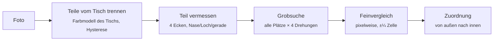

# Puzzlehelfer

[](https://github.com/michaelkrisper/puzzlehelfer/actions/workflows/ci.yml)
[](LICENSE)
[](https://michaelkrisper.github.io/puzzlehelfer/)

Puzzleteile fotografieren und erfahren, wo sie hingehören und wie herum. Die
App vergleicht jedes Teil mit dem Bild auf der Schachtel und prüft, ob Nasen,
Löcher und gerade Kanten passen. Alles läuft im Browser, kein Foto verlässt
das Gerät.

**→ [michaelkrisper.github.io/puzzlehelfer](https://michaelkrisper.github.io/puzzlehelfer/)**

<p align="center">
  
</p>

## Benutzung

1. **Vorlage:** das Bild des fertigen Puzzles fotografieren (Schachteldeckel)
   oder ein Bild wählen, etwa vom Hersteller. Die App sucht die Bildecken
   selbst; bei Bedarf mit dem Finger nachziehen.
2. **Teilezahl** antippen oder eintippen. Das Raster ergibt sich aus Zahl und
   Seitenverhältnis und lässt sich mit −/+ korrigieren.
3. **Teile fotografieren:** mit etwas Abstand zueinander, Bildseite nach oben,
   auf einem möglichst einfarbigen Tisch, gerade von oben. Das halbfertige
   Puzzle darf mit aufs Foto.
4. Ergebnis: jedes erkannte Teil hat eine **Nummer**, ein **Bogenpfeil** zeigt
   Drehrichtung und Grad. Liegt das halbfertige Puzzle im Foto, zeigt ein
   **Pfeil** direkt auf den Platz. Darunter sind die Plätze in der Vorlage
   markiert. Ein Teil antippen zeigt es richtig gedreht neben seinem Platz.
5. Teile einsetzen, **neue Runde**, wieder fotografieren. Mit jedem
   eingesetzten Teil kennt die App mehr Lücken und findet weitere Teile.

Mehrere Fotos in einer Runde sind möglich (mehr Teile oder Nahaufnahmen). Ein
Teil, das auf zwei Fotos vorkommt, wird erkannt und nur einmal verplant.

Grün heißt sicher, gelb vermutlich. Lieber ein ehrliches „vermutlich“ als ein
falsches „sicher“: In den Tests stimmen über 99 % der sicheren Vorschläge.

## Wie es funktioniert



- **Vorlage** ([`core/reference.js`](core/reference.js)): größtes Viereck im Foto
  (Kanten oder Fläche, die sich vom Tisch abhebt), innerhalb davon die erste
  durchgehende Kante nach einem gleichmäßigen Rand, damit Schachtelrand und
  Schriftzug wegfallen. Das Bild wird entzerrt und in Zellen geteilt.
- **Teile trennen** ([`core/segment.js`](core/segment.js)): Der Tisch füllt den
  Bildrand; dessen häufigste Farbtöne bilden das Tischmodell. Pixel, die
  deutlich abweichen, sind Puzzle. Ein Teil muss einen deutlich abweichenden
  Kern haben und reicht bis zu einer niedrigeren Schwelle (Hysterese), so
  bleiben Umrisse sauber und Maserung fällt weg. Zusätzlich schärft GrabCut
  jeden Umriss nach; genommen wird die Variante mit der besseren Form. Alle
  Pixelmaße sind auf rund 90 px Teilgröße abgestimmt, das Foto wird passend
  skaliert.
- **Teil vermessen** ([`core/piece.js`](core/piece.js)): Die geraden Stücke aller
  vier Seiten teilen eine Richtung (modulo 90°), daraus folgen Lage und Ecken.
  Klappt das nicht, sucht ein zweiter Weg scharfe 90°-Ecken mit geraden
  Schenkeln. Jede Seite wird als Kurve aus 24 Punkten gespeichert: Größe und
  Lage der Nase, Halsbreite, Krümmung.
- **Vergleich** ([`core/match.js`](core/match.js)): Erst grob über Blockmittel
  an allen Plätzen und Drehungen (Ränder nur dort, wo das Teil gerade Seiten
  hat, gerade Seite nach außen), dann pixelweise um die besten Kandidaten.
  Helligkeit und Farbe werden je Kandidat angeglichen, das macht den
  Vergleich unempfindlich gegen Spiegelungen und Farbstich der Vorlage.
- **Zuordnung:** immer das sicherste Teil zuerst. Seine Nasen und Löcher
  werden zu Bedingungen für die Nachbarplätze, wie beim Puzzeln von Hand.
  Mitten im Leeren braucht ein Vorschlag mehr Sicherheit als am Rand oder
  neben schon liegenden Teilen, so wächst die Lösung von außen nach innen.
- **Halbfertiges Puzzle** ([`core/board.js`](core/board.js)): Merkmalspunkte
  (ORB) legen das fertige Stück per Homographie auf die Vorlage. Daraus
  folgen die belegten Plätze, der Farbabgleich zwischen Foto und Vorlage und
  der genaue Umriss jeder Lücke, der mit den Seitenkurven der Teile
  verglichen wird.

## Entwicklung

Vanilla JS ohne Build, OpenCV.js im Web Worker ([`worker.js`](worker.js)).

```sh
npm install
npm run serve          # http://localhost:8793
npm run check          # Biome + Tests
npm run test:e2e       # headless Chrome, startet eigenen Server
```

Die Tests brauchen `python3` mit `numpy` und `Pillow`:
[`tools/synth.py`](tools/synth.py) erzeugt künstliche Fotos mit bekannter
Lösung (Puzzle zerschneiden, Teile verdreht auf einen Tisch legen, optional
ein halbfertiges Puzzle mit Perspektive, Schatten, Rauschen, JPEG) und
[`tools/bench.mjs`](tools/bench.mjs) misst Erkennung und Zuordnung darauf,
auch mit absichtlich schlechter Vorlage (`--badref`).

```sh
python3 tools/synth.py --image tests/fixtures/picture.jpg --pieces 100 --seed 1 --out /pfad/szene
node tools/bench.mjs /pfad/szene [--badref]
```

Nach Änderungen an App-Dateien `VERSION` in [`sw.js`](sw.js) hochzählen.

## Grenzen

- Teile dürfen sich nicht berühren; aneinanderliegende Teile werden als
  „unklar“ markiert.
- Sehr einfarbige Flächen (Himmel, Meer) lassen sich aus dem Bild allein kaum
  zuordnen. Hier helfen die Lücken im halbfertigen Puzzle.
- Puzzles mit unregelmäßigem Schnitt (keine Reihen und Spalten) werden nicht
  unterstützt.
- Getestet an künstlichen Fotos; echte Handyfotos sind die nächste Probe.

## Lizenz

MIT, siehe [`LICENSE`](LICENSE). OpenCV.js: Apache-2.0, siehe
[`vendor/README.md`](vendor/README.md). Testbild: siehe
[`tests/fixtures/SOURCES.md`](tests/fixtures/SOURCES.md).
