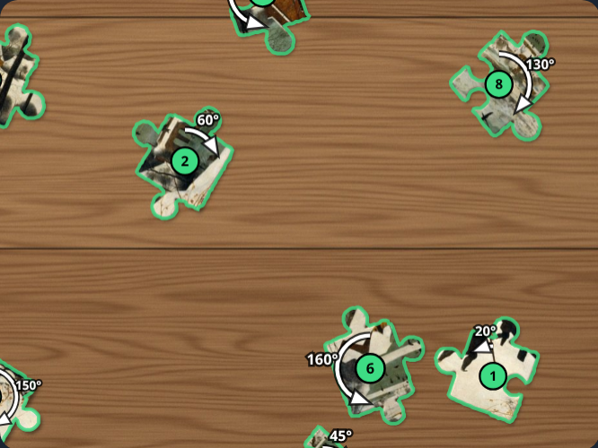
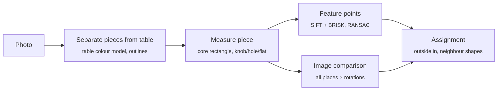

# Puzzlehelfer

[](https://github.com/michaelkrisper/puzzlehelfer/actions/workflows/ci.yml)
[](LICENSE)
[](https://michaelkrisper.github.io/puzzlehelfer/)

Take a photo of jigsaw pieces and find out where they belong and which way
round. The app compares every piece with the picture on the box and checks
whether knobs, holes and straight edges fit. Everything runs in the browser;
no photo leaves the device. The app's interface is in German.

**→ [michaelkrisper.github.io/puzzlehelfer](https://michaelkrisper.github.io/puzzlehelfer/)**

<p align="center">
  
</p>

## Usage

1. **Reference:** take a photo of the finished picture (box lid or poster) or
   pick an image, e.g. from the manufacturer. The app finds the picture
   corners itself; drag them with a finger if needed.
2. **Piece count** (required, usually printed on the box): tap or type it.
   Columns × rows follow from count and aspect ratio; rectangular pieces
   (e.g. 12 × 20 for 240) are recognised from the finished border in the
   first photo. Correct it with −/+ if needed.
3. Switch to the **Teile** tab at the bottom.
4. **Photograph pieces:** picture side up, a little apart, straight from
   above. The half-finished puzzle may be in the photo, and it helps a lot:
   occupied places, colour calibration and the exact geometry come from it.
5. Result: every recognised piece has a **number**, a **curved arrow** shows
   direction and degrees of rotation. If the half-finished puzzle is in the
   photo, a **straight arrow** points at the place. Pieces you have already
   joined into a group get a **letter** and are placed as a whole. Below, the
   places are marked on the reference. Tap a piece to see it rotated next to
   its place.
6. Put pieces in, **new round**, photograph again. Every placed piece gives
   the app more gaps to work with.

Several photos per round are possible (more pieces or close-ups; pick
several at once with "Bild wählen"). Easiest is **Tisch abfahren**: the
camera runs in the app; move the phone slowly over the table and hold it
still for a moment every third of a picture, it takes a photo each time.
All photos are put together into one picture of the table from above
("Tisch von oben", the default with two or more): photos with some of the
finished part by it, the others (close-ups of a tray) onto a photo they
overlap. A photo that overlaps none is marked "nicht eingeordnet". The
newest photo wins: photograph a spot again after putting pieces in or
laying them out anew, and the table shows its new state. A piece on two
photos taken together lies at the same spot and is planned once.
"Korrigieren" there crops the table (drag the corners, pieces outside are
ignored) and toggles places the recognition got wrong (tap: free/filled).

Pieces are numbered by probability: 1 is the likeliest, the step card shows
the percentage. An honest low percentage is better than a wrong "sure".

At the end, with plain pieces and a finished part around the gaps, the card
works **by gap** ("Nach Lücke"): a gap with two or three finished
neighbours and the three pieces whose outline fits it best, the clearest
gaps first. The card shows the gap as the photo sees it next to the piece,
cut from the photo and already turned as it goes in, at the same scale, and
below where the piece lies on the table (ringed): one try fits one screen,
without zooming. Try them in turn: **Passt** puts the piece in, **Passt
nicht** rules that piece out at that gap. A piece put in lends its outline
as the rim of its free neighbours, so a hole fills from its border inward.
"Nach Teil" switches back to one piece with its places. Every "Passt" / "Passt nicht" is kept on the phone;
**Versuche exportieren** saves them as JSON (photo name, piece position,
place, rotation, result) to check and improve the recognition with real
solutions.

## How it works



- **Reference** ([`core/reference.js`](core/reference.js)): largest
  quadrilateral in the photo (edges, or an area that stands out from the
  table), inside it the first continuous edge after a uniform margin, so box
  border and lettering are dropped. The picture is rectified and split into
  cells. A high-resolution copy in the true aspect ratio carries the feature
  points (SIFT, BRISK).
- **Separating pieces** ([`core/segment.js`](core/segment.js)): the table
  fills the image border; its most frequent colours of the same hue form the
  table model (wood grain, light falloff). Pixels that differ clearly are
  puzzle. A piece needs a clearly different core and extends to a lower
  threshold (hysteresis). Brown pieces on wood are hard to tell apart by
  colour, but the cardboard edge draws a closed outline with a lot of local
  structure: strong structure near a detected piece is added and the piece
  is filled within its outline. Pieces that broke into fragments are joined.
  If the shape is poor, GrabCut refines the outline. All pixel sizes are
  tuned to pieces of about 90 px; the photo is scaled accordingly.
- **Measuring a piece** ([`core/piece.js`](core/piece.js)): the straight
  parts of all four sides share a direction (modulo 90°), which gives
  position and corners. A second way looks for sharp 90° corners with
  straight legs. Pieces with big knobs and wavy cuts have hardly anything
  straight; for those the piece area is projected onto rows and columns at
  every angle: at the right angle the profiles jump sharply at every core
  edge. The core size comes from the finished part on the table. Each side
  is stored as a curve of 24 points: size and position of the knob, neck
  width, curvature.
- **Feature points** ([`core/feature.js`](core/feature.js)): SIFT and BRISK
  points of each piece are matched against the reference, RANSAC estimates
  rotation, scale and shift. This finds a piece regardless of its shape and
  is very reliable on fur, lettering and faces; on plain areas there are no
  points, there the image comparison decides. A match with several
  consistent points becomes a strong vote in the assignment.
- **Image comparison** ([`core/match.js`](core/match.js)): coarse over block
  means at all places and rotations (edges only where the piece has straight
  sides, straight side outwards), then pixel by pixel around the best
  candidates. Brightness and colour are fitted per candidate, which makes the
  comparison robust against reflections and colour cast of the reference.
  Rectangular pieces only fit with the long side along the long cell side.
- **Outline fit** ([`core/fit.js`](core/fit.js)): at the edge of a finished
  part each piece is laid into each gap whose knobs and holes it matches,
  on the table seen from above: the start comes from the corners, then turn
  and shift are fitted so that the gap's rim (the finished part's outline
  from corner to corner) lies on the piece's outline. The mean distance
  decides among plain pieces, where colour says little and the corners of
  one piece vary by 5 % from photo to photo. Piece outlines are traced again
  at the photo's full resolution for this.
- **Assignment:** always the surest piece first. Its knobs and holes become
  constraints for the neighbouring places, just like solving by hand. In the
  middle of nowhere a suggestion needs more certainty than at the edge or
  next to placed pieces, so the solution grows from the outside in.
- **Half-finished puzzle** ([`core/board.js`](core/board.js)): feature points
  map the finished part onto the reference: a homography plus a smooth cubic
  correction. The finished part lies flat on the table, so this also
  straightens a reference that was photographed bent or wavy. From this
  follow the occupied places, the colour calibration between photo and
  reference, the exact outline of every gap (compared with the side curves
  of the pieces) and the cell size at every point of the table. Groups of
  pieces you joined yourself are located as a whole.

## Development

Vanilla JS without a build step, OpenCV.js in a web worker
([`worker.js`](worker.js)).

```sh
npm install
npm run serve          # http://localhost:8793
npm run check          # Biome + tests
npm run test:e2e       # headless Chrome, starts its own server
```

The tests need `python3` with `numpy` and `Pillow`:
[`tools/synth.py`](tools/synth.py) creates artificial photos with a known
solution (cut a puzzle, lay pieces rotated on a table, optionally a
half-finished puzzle with perspective, shadows, noise, JPEG) and
[`tools/bench.mjs`](tools/bench.mjs) measures detection and assignment on
them, also with a deliberately poor reference (`--badref`).

```sh
python3 tools/synth.py --image tests/fixtures/picture.jpg --pieces 100 --seed 1 --out /path/scene
node tools/bench.mjs /path/scene [--badref]
```

After changing app files, bump `VERSION` in [`sw.js`](sw.js).

## Limits

- Pieces should not touch; pieces lying against each other are located as a
  group if feature points allow it, otherwise marked "unclear".
- Very plain areas (sky, sea) can hardly be placed from the picture alone.
  The gaps in the half-finished puzzle help here.
- Puzzles with irregular cuts (no rows and columns) are not supported.
- The grid is first derived from the piece count assuming square pieces.
  For rectangular pieces it is corrected from the first photo that shows the
  finished border; without a border set columns and rows with −/+.
- Analysing a photo takes about 15 s on a mid-range phone (Pixel 4a) and
  needs WebAssembly SIMD (Chrome 91, Safari 16.4, Firefox 89 or newer).

## Contributing

Bug reports with photos and pull requests are welcome, see
[`CONTRIBUTING.md`](CONTRIBUTING.md). Changes are listed in
[`CHANGELOG.md`](CHANGELOG.md).

## License

MIT, see [`LICENSE`](LICENSE). OpenCV.js: Apache-2.0, see
[`vendor/README.md`](vendor/README.md). Test image: see
[`tests/fixtures/SOURCES.md`](tests/fixtures/SOURCES.md).
